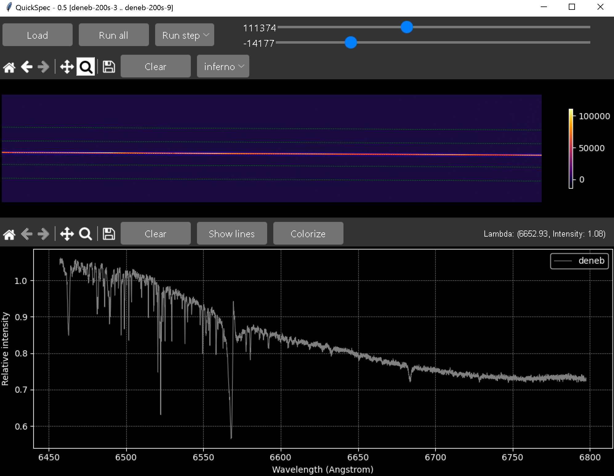

# QuickSpec


Quick-look spectra reduction &amp; calibration tool - aimed at demonstrating spectroscopy science to public or students

:warning: does not produce science-quality spectra - please use instead:

- [specinti](https://solex.astrosurf.com/specinti1_fr.html)
- [demetra](https://www.shelyak.com/logiciel/logiciel-demetra/)
- [spcaudace](http://spcaudace.free.fr)

# Functions
- images viewer with cuts level, zoom, pan, registration and auto sum
- spectra colorized viewer with selected lines display
- one-click images reducer, registration, spectrum extract, calibration, response and normalisation processing
- automatic processing when a new spectra is captured
- single parameter file with changes dynamically applied
- (new) SA100 3-click process 

# Current limits
- only 2D FITS format images can be read
- only 1D FITS or DAT (2-columns) format spectra can be read
- generated spectra can only be saved as images

# Pre-requisites
- DOF (bias, dark, flat) and response reference files are to be generated by another app

# Installation
from binaries (not ready yet)

from sources:

- download and install a python interpreter: [miniforge](https://github.com/conda-forge/miniforge)
- clone QuickSpec sources: ```$ git clone https://github.com/plouis35/QuickSpec.git``` (or download zip)
- create a new python environment: ```$ conda env create --file environment.yml```
- go to cloned directory: ```$ cd quickspec```
- and run Quickspec : ```$ python quickspec.py```

# Basic usage
- move the QuickSpec console window so that output logging information is always visible
- press ```load`` button to navigate to and select spectra and/or calibration images; when images, they will automatically be reduced, registered and summed before display (DOF are ignored when not existing) 
- use a text editor to open and adjust the parameter file created under that images directory (**quickspec.ini**); it is recommended to open the calibration images first in order to define the proper x-pixel / wavelength tuples
- select ```longslit - process all``` menu to generate a calibrated spectrum for longslite spectra
- select ```slitless - 3-clics process``` menu to select zero order, trace and sky in order to generate a calibrated spectrum for SA100 spectra
- press ```colorize``` or ```show lines``` to visualize spectrum properties
- press ```clear``` or any panel to reset loaded data

# (new) Y-crop FITS images from the console

```bash
python -m tools.crop_fits "images/*.fits" --center 0.5 --size 0.2
```

This tool crops only vertically and preserves the full image width. `--center`
is the relative vertical center from 0 to 1 (`0.5` is the image center), and
`--size` is the fraction of image height kept on either side of that center:
`0.2` therefore keeps 20% above and 20% below, or 40% of the height in total.
Quote wildcard patterns so they are expanded by the program. Each result is
written beside its source as `<original-name>_cropped.<original-extension>`;
existing files are not overwritten.
